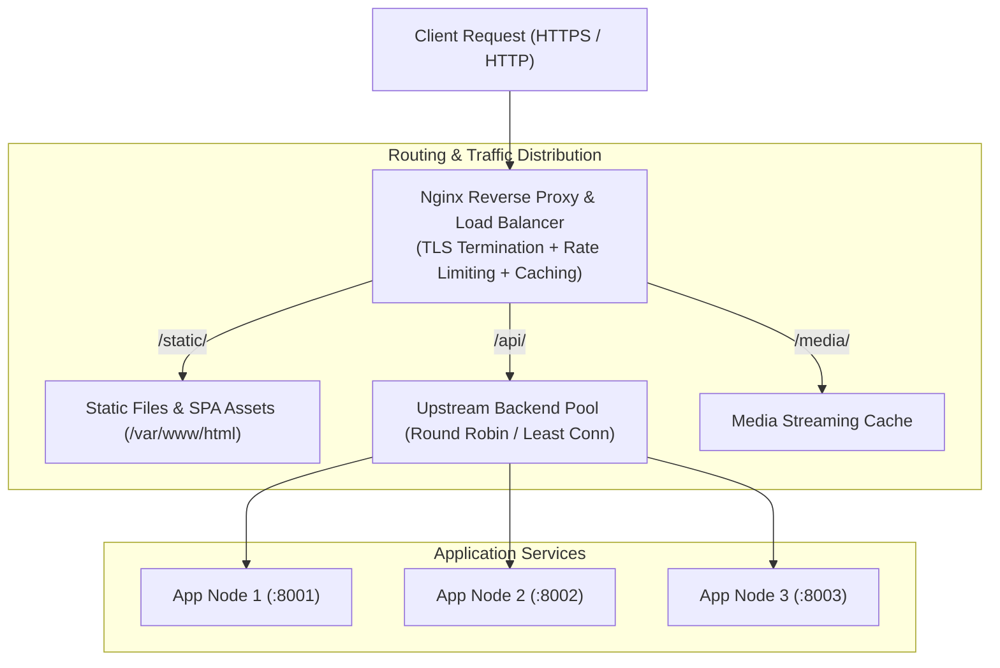

# Mastering Nginx — Complete Guide with Tutorials and Projects

<p align="center">
  <a href="https://github.com/codewithmuh/nginx-tutorial-series/releases"></a>
  <a href="./scripts/validate-configs.sh"></a>
  <a href="https://github.com/codewithmuh/nginx-tutorial-series/stargazers"></a>
  <a href="https://github.com/codewithmuh/nginx-tutorial-series/network/members"></a>
  <a href="./LICENSE"></a>
  <a href="https://youtube.com/@codewithmuh"></a>
  <a href="https://www.linkedin.com/in/muhammad-rashid-daha/"></a>
  <br>
  
  
  
</p>

A hands-on Nginx course in 13 chapters, from `apt install nginx` to blue-green
deployments — with **every config file commented line by line and validated
against a real Nginx**.

Companion repo for the [@codewithmuh](https://youtube.com/@codewithmuh) video
series. Works fine on its own, too.




---

## Start here

**Never touched Nginx?** → [Chapter 01 — Introduction](./01-introduction/)

**Want something running in 30 seconds?** No install, no `sudo`:

```bash
git clone https://github.com/codewithmuh/nginx-tutorial-series.git
cd nginx-tutorial-series/demo
docker compose up
```

```bash
curl http://localhost:8080/            # static site served by Nginx
curl http://localhost:8080/api/hello   # proxied to a backend container
```

That's chapter 13's Project 1, running. Edit
[`demo/nginx/default.conf`](./demo/nginx/default.conf), restart, watch what
changes. Details in [`demo/README.md`](./demo/README.md).

**Here to solve one specific problem?** Jump straight to it:

| I want to… | Go to |
|---|---|
| Host a static site or SPA | [03](./03-hosting-static-websites/), [13 §1](./13-real-world-nginx-projects/) |
| Put Nginx in front of Node/Django/Rails | [04](./04-reverse-proxy-with-nginx/) |
| Fix a `502 Bad Gateway` | [04 §8](./04-reverse-proxy-with-nginx/#8-troubleshooting), [11 §10](./11-debuging-and-monitoring/#10-common-errors-decoded) |
| Add free HTTPS | [06](./06-ssl-with-nginx/) |
| Split traffic across several servers | [05](./05-load-balancing/) |
| Redirect old URLs to new ones | [07](./07-url-rewriting-and-redirects/) |
| Stop bots and brute-force attempts | [08](./08-security-with-nginx/) |
| Make a slow site fast | [09](./09-optimzing-nginx-for-performance/) |
| Stream video, or gate paid downloads | [10](./10-nginx-as-a-media-server/) |
| Understand what my logs are telling me | [11](./11-debuging-and-monitoring/) |
| Serve WordPress / PHP | [13 §2](./13-real-world-nginx-projects/) |
| Deploy with zero downtime | [13 §5](./13-real-world-nginx-projects/) |

---

## The chapters

| # | Chapter | What you'll be able to do |
|---|---|---|
| 01 | [Introduction](./01-introduction/) | Install Nginx, start/stop it, understand what it's for |
| 02 | [Nginx Basics](./02-nginx-basics/) | Read any `nginx.conf`; know what every context does |
| 03 | [Hosting Static Websites](./03-hosting-static-websites/) | Serve a real site with caching, gzip and a custom 404 |
| 04 | [Reverse Proxy](./04-reverse-proxy-with-nginx/) | Front any app server; forward headers and WebSockets correctly |
| 05 | [Load Balancing](./05-load-balancing/) | Spread traffic, fail over automatically, drain nodes for deploys |
| 06 | [SSL/TLS](./06-ssl-with-nginx/) | Free auto-renewing HTTPS, A+ rated, with HSTS |
| 07 | [Rewriting & Redirects](./07-url-rewriting-and-redirects/) | Move URLs without breaking links; `root` vs `alias` for good |
| 08 | [Security](./08-security-with-nginx/) | Rate limits, security headers, IP rules, hidden-file blocking |
| 09 | [Performance](./09-optimzing-nginx-for-performance/) | Caching, compression, keepalive — and how to measure the gain |
| 10 | [Media Server](./10-nginx-as-a-media-server/) | Byte ranges, HLS, throttling, signed URLs for paid content |
| 11 | [Debugging & Monitoring](./11-debuging-and-monitoring/) | Logs worth reading, trace IDs, metrics, health checks |
| 12 | [Best Practices](./12-best-practises-and-resources/) | Maintainable config layout, deploy ritual, production checklist |
| 13 | [Real-World Projects](./13-real-world-nginx-projects/) | SPA+API, WordPress, API gateway, maintenance mode, blue-green |

Each chapter is a `README.md` you can read on its own, plus a fully commented
`.conf` file you can copy.

---

## Every config here actually works

No config in this repo is aspirational. They are all checked against a real
Nginx binary:

```bash
./scripts/validate-configs.sh
```

```
PASS  ./01-introduction/example-config.conf
PASS  ./02-nginx-basics/basic-confg.conf
...
13 passed, 0 failed
All configs are valid.
```

It uses Docker (`nginx:alpine`) when available so results are identical
everywhere, and falls back to a locally installed `nginx`. Run it before
sending a pull request.

---

## How to use a config from this repo

The `.conf` files are server blocks meant to be dropped in as a site file:

```bash
# Ubuntu / Debian
sudo cp 03-hosting-static-websites/nginx-static.conf /etc/nginx/sites-available/mysite.conf
sudo ln -s /etc/nginx/sites-available/mysite.conf /etc/nginx/sites-enabled/

# CentOS / RHEL / Fedora
sudo cp 03-hosting-static-websites/nginx-static.conf /etc/nginx/conf.d/mysite.conf

# macOS (Homebrew)
cp 03-hosting-static-websites/nginx-static.conf /opt/homebrew/etc/nginx/servers/

# Then, always:
sudo nginx -t          # validate BEFORE reloading
sudo nginx -s reload   # graceful reload, no dropped connections
```

Edit the `server_name`, `root` and certificate paths for your own setup.
[Chapter 02](./02-nginx-basics/) explains why the file is laid out that way.

**The one habit worth building:** `nginx -t` before every reload. If it fails,
your old config is still running and nothing broke.

---

## Repository layout

```
nginx-tutorial-series/
├── 01-introduction/ … 13-real-world-nginx-projects/
│   ├── README.md                  # the chapter
│   └── *.conf                     # annotated, validated config
├── 03-hosting-static-websites/
│   └── website-files/             # a real demo site to serve
├── demo/                          # docker compose stack you can run now
│   ├── compose.yaml
│   ├── nginx/default.conf
│   └── api/server.js
├── scripts/
│   └── validate-configs.sh        # checks every .conf with real nginx
├── CONTRIBUTING.md
└── LICENSE
```

---

## Requirements

Nothing, to read. To follow along:

- **Nginx 1.18+** — `nginx -v` (the `http2 on;` syntax in ch. 06 needs 1.25.1+)
- **A terminal and `sudo`** on the machine you're configuring
- **Docker** *(optional)* — for the demo stack and the validator
- **A domain + server** *(only for ch. 06)* — HTTPS needs a real domain

No prior Nginx knowledge assumed. Basic comfort with the command line helps.

---

## Video series & articles

Chapters map to videos on [@codewithmuh](https://youtube.com/@codewithmuh), with
written versions on [Medium](https://medium.com/@codewithmuh). Each chapter
stands alone — you don't need the video to follow the text.

## Contributing

Found a mistake, or have a config that saved your day? Pull requests welcome —
see [CONTRIBUTING.md](./CONTRIBUTING.md). Run `./scripts/validate-configs.sh`
before you open one.

## License

[MIT](./LICENSE) — use these configs anywhere, including at work.

## Contact

Questions or suggestions:
[LinkedIn](https://www.linkedin.com/in/muhammad-rashid-daha/) ·
[YouTube](https://youtube.com/@codewithmuh) ·
[Medium](https://medium.com/@codewithmuh)

---

⭐ If this saved you an afternoon, a star helps other people find it.
